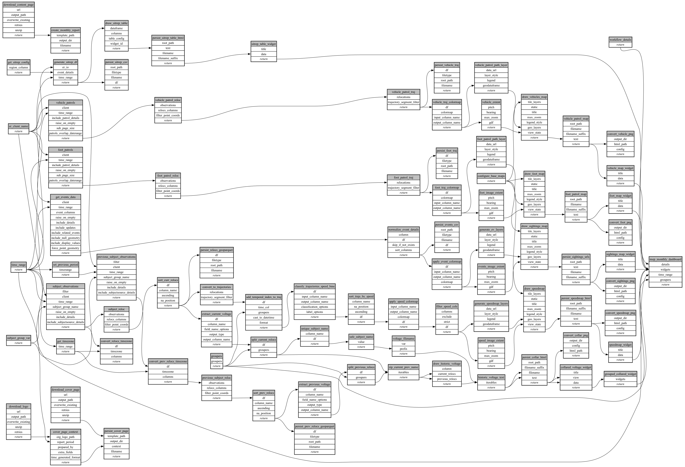

```
# AUTOGENERATED BY ECOSCOPE-WORKFLOWS; see fingerprint in README.md for details

```

```yaml
# fingerprint:
artifacts_sha256_basic: 7abb690653ea99e0eb5f20f9477d52bcf1f7e7e02eec8c70ca4138d259776a48
artifacts_sha256_strict: a4b70dad8c275d09fc0824366be6c7818e70b7d03adb6b758d44ac219c210100
installed_requirements:
- channel: https://repo.prefix.dev/ecoscope-workflows/
  name: ecoscope-platform
  version: {version: ==2.15.1}
- channel: https://repo.prefix.dev/ecoscope-workflows-custom/
  name: ecoscope-workflows-ext-custom
  version: {version: ==0.1.0rc14}
- channel: https://repo.prefix.dev/ecoscope-workflows-custom/
  name: ecoscope-workflows-ext-ste
  version: {version: ==0.0.0rc1}
- channel: https://repo.prefix.dev/ecoscope-workflows-custom/
  name: ecoscope-workflows-ext-mep
  version: {version: ==1.0.1}
- channel: conda-forge
  name: pydeck
  version: {version: ==0.9.2}
- channel: conda-forge
  name: opentelemetry-sdk
  version: {version: ==1.45.1}
params_sha256: 7a734aa43309e4335e1aadc6159a1bcc8963de0ada4a6c47ada22047afb26148
spec_sha256: d241201060ba626f95ad0e76702aee160e730270a0989221cde21efcd77000b8

```

# ecoscope-workflows-monthly-report-workflow


